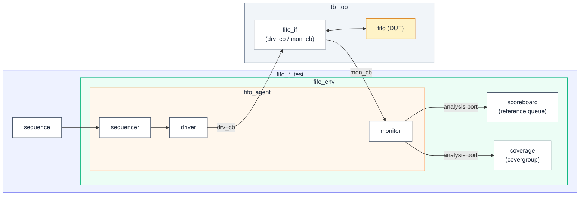

# UVM FIFO Verification

UVM testbench for a synchronous FIFO (DEPTH=8, WIDTH=8). Internship learning project.

> This is a supervised internship learning project that will be presented, so no vibe coding was used.

**Run it online:** [EDA Playground](https://edaplayground.com/x/DGuA) (Cadence Xcelium, UVM 1.2)
Select a test with `+UVM_TESTNAME=<test>` in Run options.

## Architecture

## Results

| Test | Functional coverage | Scoreboard |
|---|---|---|
| fifo_basic_test | 58.1% | 5/5 pass |
| fifo_fill_drain_test | 90.3% | 28/28 pass |
| fifo_rw_test | 98.1% | 51/51 pass |
| fifo_random_test (seed 1) | 100% | 976/976 pass |
| fifo_override_test (seed 1) | 98.1% | 832/832 pass |

## Bug injection

The RTL contains three intentional bugs behind defines. Add one to Compile options (e.g. `+define+BUG_FULL_OFF_BY_ONE`) and run `fifo_fill_drain_test`; the scoreboard should report `UVM_ERROR`s.

| Define | Bug | Caught by |
|---|---|---|
| `BUG_FULL_OFF_BY_ONE` | `full` asserts at 7 entries | flag check |
| `BUG_WRITE_WHEN_FULL` | write accepted when full, overwrites oldest entry | flag check, data compare |
| `BUG_PTR_WRAP` | write pointer wraps one entry early | data compare |